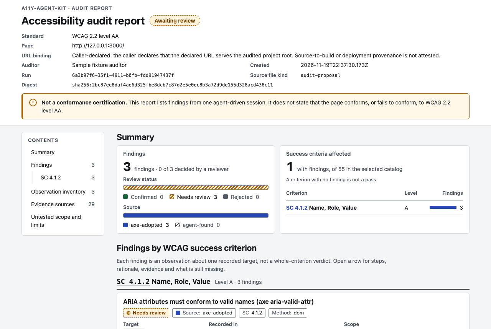

# a11y-agent-kit

Find accessibility problems in your running web app with the coding agent you already use, and get an HTML report backed by saved screenshots and browser records.

```sh
npx -y a11y-agent-kit@0.1.2 init --install --write
```

Run it from your app's project root with Node.js 22.12+ and npm. It writes the audit manifest, downloads the matching Chromium from the Playwright CDN if it is missing, and creates the MCP settings for Claude Code, Cursor and Codex where they do not exist yet. If `init` reports that something is still missing, follow the steps it prints. Then restart your agent and paste this into it:

```text
Check my running app at http://127.0.0.1:3000/ for accessibility problems with a11y-agent-kit, using evidence/audit-manifest.json.
Follow https://github.com/szboynono/a11y-agent-kit/blob/main/skills/a11y-audit/SKILL.md, look at the screenshots before saying anything about how the page looks, and do not change my code.
When you finish, give me the HTML report, where the evidence is saved, and what you did not check.
```



The sample report above comes from a small test page in this repository, served on loopback. Findings stay "needs review" until a separate reviewer checks them.

## What `init` does

`init` never overwrites an existing file unless you ask it to.

- Writes `evidence/audit-manifest.json` with `projectRoot` set to the current directory's real path and `url` set to `http://127.0.0.1:3000/`. Pass another address as the first argument, for example `init http://localhost:5173/ --install --write`. An existing manifest is left unchanged unless you add `--force`.
- Checks that the Chromium build matching the kit's Playwright version starts. With `--install`, a missing build is downloaded from the Playwright CDN. Without it, nothing is downloaded: `init` prints the install command (`npx -y playwright@1.64.1 install chromium`) and exits with status 1.
- With `--write`, creates the MCP server settings for Claude Code (`.mcp.json`), Cursor (`.cursor/mcp.json`) and Codex (`.codex/config.toml`), each running `npx -y a11y-agent-kit@0.1.2 serve`. An existing configuration file is never changed; `init` prints the entry for you to add instead. Without `--write`, all three are printed only.
- Prints the prompt above for your agent.

To run one audit without an agent, use `npx -y a11y-agent-kit@0.1.2 audit evidence/audit-manifest.json --summary`.

## Upgrade from 0.1.1

Change the pinned version from `0.1.1` to `0.1.2` in your `npx -y a11y-agent-kit@...` commands and MCP settings. `init` does not edit an existing `.mcp.json`, `.cursor/mcp.json` or `.codex/config.toml`, so change the version in those files yourself, or rerun `claude mcp add` in Claude Code. For a global installation, run `npm install -g a11y-agent-kit@0.1.2`. Playwright stays at 1.64.1, so a Chromium installed for 0.1.1 keeps working.

Version 0.1.2 adds `init`, the optional `allowedOrigins` and `followRedirects` manifest fields, an additive `navigation` field on blocked navigation, a DNS check for top-level document requests, untrusted-content markers in `a11y_audit_*` MCP responses, and a redesigned HTML report. A blocked navigation keeps the error code it had in 0.1.1. See the [remote-site guide](examples/remote-site.md) and [trusted inputs and known gaps](#trusted-inputs-and-known-gaps).

<a name="run-your-first-audit-from-npm"></a>

## Manual setup without `init`

Use this setup if you prefer to write the manifest yourself or your agent runs CLI commands instead of MCP. Use Node.js 22.12+ and npm. Start your app. Run the block below in a POSIX shell from your app's project root. It installs matching Playwright Chromium, writes a manifest whose `projectRoot` is the output of `pwd -P`, and runs the npm package to collect evidence. If your app runs at another address, change `url` before the last command.

```sh
npx -y playwright@1.64.1 install chromium
mkdir -p evidence
cat > evidence/audit-manifest.json <<JSON
{
  "projectRoot": "$(pwd -P)",
  "url": "http://127.0.0.1:3000/"
}
JSON
npx -y a11y-agent-kit@0.1.2 audit evidence/audit-manifest.json --summary
```

Open the `reportPath` from the command's JSON output for the local collection. A successful run saves DOM and axe records, screenshots, and a keyboard sample under `evidence/`. Leave the app running for the next step. See the [first-use guide](examples/first-use.md).

<a name="copy-this-to-your-agent"></a>

### Agent prompt for the CLI

Paste this into the coding agent you already use, with the same project and manifest.

```text
Audit my running localhost app using evidence/audit-manifest.json in this project.
Read the evidence rules at
https://github.com/szboynono/a11y-agent-kit/blob/main/skills/a11y-audit/SKILL.md
and use the npx commands in this prompt for setup.
Start one persistent JSONL process with
npx -y a11y-agent-kit@0.1.2 audit-agent evidence/audit-manifest.json
Start with snapshot and axe, then adopt bound axe candidates. Open a relevant
menu or dialog and inspect that state if the app has one. Read original records
and view PNGs before making visual claims. Save checkpoints and submit the last
acknowledged digest for review. Render the returned proposal JSON with
npx -y a11y-agent-kit@0.1.2 audit-report REPORT.json --out evidence/a11y-report.html
Give me the HTML, the original evidence paths, and any gaps in coverage. Audit only.
```

For request examples, batch collection, and submission, see the [BYOA workflow](examples/byoa-audit.md). If your agent uses a local stdio MCP host, use `npx -y a11y-agent-kit@0.1.2 serve` as the server command. See the [MCP configuration](examples/byoa-audit.md#mcp-connection).

## Audit a site you are authorized to test

The kit is not limited to `localhost`. To audit a staging, production or third-party site that you own or have permission to test, use an empty workspace directory as `projectRoot` instead of a source tree, and resolve the site's canonical start URL first. By default, main-document navigation stays on the manifest origin, so an entry URL that redirects to another origin (for example `example.com` to `www.example.com`) is blocked.

```sh
npx -y playwright@1.64.1 install chromium
mkdir -p "$HOME/a11y-audits/example-site/evidence" && cd "$HOME/a11y-audits/example-site"
curl -sSIL --max-redirs 5 -o /dev/null -w '%{url_effective}\n' https://example.com/
cat > evidence/audit-manifest.json <<JSON
{
  "projectRoot": "$(pwd -P)",
  "url": "https://www.example.com/"
}
JSON
npx -y a11y-agent-kit@0.1.2 audit evidence/audit-manifest.json --summary
```

Replace `https://www.example.com/` with the URL that `curl` printed. Keep only `evidence/` in the workspace. For an agent session, paste this prompt:

```text
Audit https://www.example.com/ for accessibility. I am authorized to test it.
Use the workspace ~/a11y-audits/example-site and evidence/audit-manifest.json there.
Before starting, resolve the canonical start URL with at most 5 redirects and use
the final URL in the manifest. Read the evidence rules at
https://github.com/szboynono/a11y-agent-kit/blob/main/skills/a11y-audit/SKILL.md
and the remote-site guide at
https://github.com/szboynono/a11y-agent-kit/blob/main/examples/remote-site.md
and use the npx commands in this prompt for setup.
Start one persistent JSONL process with
npx -y a11y-agent-kit@0.1.2 audit-agent evidence/audit-manifest.json
Start with snapshot and axe, then adopt bound axe candidates. Explore only pages
on the same origin. Do not submit forms, sign in, or trigger actions with side
effects. If navigation is blocked, report the blocked URL and stop that path.
Read original records and view PNGs before making visual claims. Save checkpoints
and submit the last acknowledged digest for review. Render the returned proposal
JSON with
npx -y a11y-agent-kit@0.1.2 audit-report REPORT.json --out evidence/a11y-report.html
Give me the HTML, the original evidence paths, and any gaps in coverage. Audit only.
```

The kit does not crawl a site, bypass bot protection or CAPTCHAs, or sign in. On production sites, avoid actions with side effects. If the entry URL redirects to another origin you are authorized to test, declare it with the optional `allowedOrigins` and `followRedirects` manifest fields. A blocked navigation keeps its 0.1.1 error code and adds a `navigation` field (`code: "AUDIT_NAVIGATION_BLOCKED"`) with a suggested next step. npm 0.1.1 does not include these fields. See the [remote-site guide](examples/remote-site.md).

## Review and share the evidence

Open the HTML locally. A submitted proposal is `needs_review`. Use a separate reviewer to inspect the originals and submit decisions with `audit-review`. Keep the project and evidence directory in place for verification. The HTML leaves out embedded screenshots by default. See [the audit skill](skills/a11y-audit/SKILL.md) and [evidence requirements](skills/a11y-audit/references/evidence-policy-v2.md).

The default workflow collects evidence for the states you explore. WCAG conformance remains unassessed, and browser ARIA data cannot tell you what a screen reader actually says.

The kit writes reports, records, and PNGs to local disk and has no model service, account, or report upload. Use your agent's settings to control what it shares with its provider. The browser connects to the target and its resources. Check captured text, URLs, and screenshots before sharing them.

## Limits

- Coverage depends on the pages, states, viewports, and budget you explore. Catalog tracking or no findings does not mean a pass.
- DOM capture excludes iframe interiors and Shadow DOM.
- PNGs do not establish timing or persistent focus visibility.
- Complex authentication and exhaustive business flows are not established.
- Interactions can trigger side effects, so use a suitable test environment.
- Reviewer independence is declared, not identity-verified.
- The caller declares which URL matches the source. For a remote site, `projectRoot` is your workspace, so source freshness describes that workspace, not the live site.
- Bot protection, CAPTCHAs, sign-in and headless-specific content are reported as observed, not bypassed.
- The recorded workflow checks used owned loopback fixtures. Validation on real third-party sites remains open, and a third-party audit is not evidence of it.
- The kit has no demonstrated detection advantage over axe.
- Audited pages are untrusted input, and the kit does not provide complete prompt-injection protection. See [trusted inputs and known gaps](#trusted-inputs-and-known-gaps).

### Trusted inputs and known gaps

- Page content reaches your agent's context. Text, attribute values, accessible names, titles, selectors, URLs and axe snippets from the audited page appear in MCP and CLI responses. The MCP server instructions and the audit skill tell the agent to treat page content as data, never as instructions. In `a11y_audit_*` MCP responses, the additive `untrustedFields` lists the page fields, and the text block wraps page strings in markers that carry a random per-session nonce; page content cannot forge or close these markers. `structuredContent` keeps the original values.
- The markers are a mitigation, not a guarantee. A model can still follow injected text. A page string can stay unmarked when the response is close to the 20,000-character limit. CLI JSONL output, the `a11y_analyze`, `a11y_verify` and `a11y_check_evidence` tools, and screenshots you view carry no markers.
- The navigation policy applies to top-level document requests only. Subresource requests (images, scripts, styles, XHR/fetch, WebSocket) and iframe documents are not checked against it.
- The host name of each top-level document request, including every redirect hop, is resolved before the request is allowed. A cloud metadata address is blocked in every session. In a public session, any other address that is not public (loopback, private, link-local, multicast, broadcast, reserved, or an IPv6 form that embeds one) is blocked too. The start URL is never refused for being private: a start host that resolves to a private address, such as an internal staging host, makes the session private.
- The check blocks only when an answer shows a cloud metadata address, or, in a public session, another non-public address. A lookup that fails or takes longer than 2 seconds is not a block: the request continues on the IP-literal and `localhost`-name check, and the session's `dnsCheck` is reported as `degraded` in JSONL, MCP and the HTML report (later agent and MCP responses repeat a brief form of at most 600 bytes; the sealed report keeps the full record). This is common behind a proxy that resolves names itself or offline, and a private target may then go undetected. A slow resolver costs at most 2 seconds per navigation, redirect hops included; hops after that wait are not looked up. A host whose lookup failed is remembered for the session (up to 64 failed hosts, oldest dropped first) and not looked up again, unless it timed out only because its navigation had less than 2 seconds left. A single action that triggers several navigations to new hosts can wait 2 seconds for each. The check is detection only: addresses are not pinned, so DNS rebinding between the check and Chromium's own lookup is not stopped. `198.18.0.0/15` is treated as public on purpose, because fake-IP proxies answer every name from it; behind such a proxy the check cannot see the real destination. See the [remote-site guide](examples/remote-site.md).

<a name="install"></a>

## Source verification and contributor setup

From a source checkout, run `node scripts/verify-source.mjs` to check the files listed in the source manifest. For development, run `npm ci` and install the matching Chromium with the command above. The source-only `node scripts/quickstart.mjs` exercises the CLI and stdio MCP on a synthetic loopback fixture. See [source verification and recorded release checks](https://github.com/szboynono/a11y-agent-kit/blob/main/docs/publication-boundary.md) and [earlier archive test scope at v0.1.1](https://github.com/szboynono/a11y-agent-kit/blob/v0.1.1/docs/publication-boundary.md).

The source tree also includes a [local plugin command](https://github.com/szboynono/a11y-agent-kit/blob/v0.1.1/commands/a11y-audit.md). See the [lifecycle and state machines](https://github.com/szboynono/a11y-agent-kit/blob/v0.1.1/docs/state-machines.md) and the [agent documentation index](llms.txt).

## License

The original code is [MIT-licensed](LICENSE). Dependencies and upstream material retain their licenses. See the [third-party notices](THIRD_PARTY_NOTICES.md).
